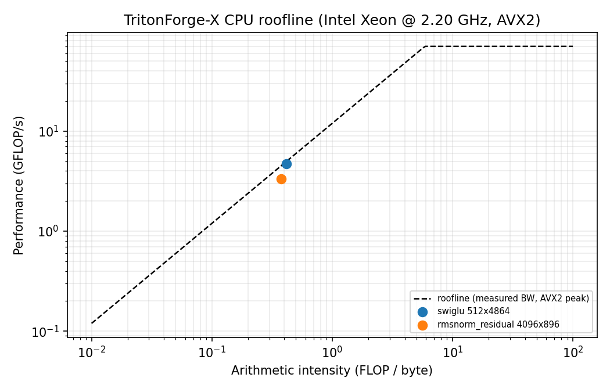

# TritonForge-X results

Generated by `python scripts/make_x_report.py` from `results/x/*.json`.
Do not hand-edit the tables.

**CPU: `Intel(R) Xeon(R) CPU @ 2.20GHz`** (2 vCPU, AVX2/FMA only, no AVX-512/AMX). See [HARDWARE.md](HARDWARE.md).

## Protocol

- Greedy decoding, 32 new tokens, 10 measured runs after 2 warmups; p95 in parentheses.
- Pinned to CPUs 0-1 with `taskset`; peak RSS is `ru_maxrss` of a single-backend process.
- wikitext-2 test: 16 windows x 512 tokens (8176 scored tokens), not the full split.
- All timing numbers are wall-clock on a shared cloud VM and will vary between runs.

## 1. Decode speed

| Backend | tok/s b1 (p95) | TTFT ms b1 (p95) | ITL ms b1 (p95) | Speedup b1 | tok/s b8 | TTFT ms b8 | ITL ms b8 | Speedup b8 |
| --- | --- | --- | --- | --- | --- | --- | --- | --- |
| PyTorch eager fp32 | 4.18 (4.80) | 618 (1119) | 229.8 (257.8) | 1.00x | 11.88 | 1740 | 640.1 | 1.00x |
| torch.compile | 4.19 (4.87) | 551 (779) | 231.5 (259.5) | 1.00x | 11.79 | 1768 | 644.0 | 0.99x |
| ONNX Runtime CPU | 4.57 (4.76) | 326 (394) | 215.6 (223.5) | 1.09x | 22.32 | 1630 | 317.4 | 1.88x |
| OpenVINO fp16 | 7.41 (7.81) | 434 (556) | 125.9 (142.3) | 1.77x | 19.71 | 2243 | 346.6 | 1.66x |
| OpenVINO int8 | 8.33 (9.15) | 386 (476) | 113.0 (140.2) | 1.99x | 20.92 | 2418 | 316.7 | 1.76x |
| OpenVINO int4 g128 | 8.33 (9.21) | 406 (567) | 112.7 (142.1) | 1.99x | 21.12 | 2141 | 322.1 | 1.78x |
| OpenVINO int4 g128 AWQ | 8.29 (9.17) | 402 (527) | 113.9 (144.8) | 1.98x | 21.11 | 2104 | 323.3 | 1.78x |

## 2. Memory and model size

| Backend | Peak RSS b1 MiB | Peak RSS b8 MiB | On-disk MB | vs OV fp16 |
| --- | --- | --- | --- | --- |
| PyTorch eager fp32 | 3402 | 3401 | 999.6 | - |
| torch.compile | 3403 | 3403 | 999.6 | - |
| ONNX Runtime CPU | 2815 | 2816 | 1993.1 | - |
| OpenVINO fp16 | 2787 | 2935 | 1009.1 | 0.0% |
| OpenVINO int8 | 1811 | 1930 | 517.0 | 48.8% |
| OpenVINO int4 g128 | 1484 | 1604 | 344.3 | 65.9% |
| OpenVINO int4 g128 AWQ | 1486 | 1605 | 344.3 | 65.9% |

## 3. Accuracy parity versus PyTorch fp32

| Variant | Top-1 agree | Max abs | Mean abs | Top-5 overlap | Mean KL | wikitext-2 PPL | dPPL |
| --- | --- | --- | --- | --- | --- | --- | --- |
| OpenVINO fp16 | 100.0% | 0.0012 | 0.0001 | 100.0% | -0.0000 | 22.012 | -0.00% |
| OpenVINO int8 | 95.4% | 2.2491 | 0.1556 | 96.3% | 0.0076 | 22.075 | 0.28% |
| OpenVINO int4 g128 | 73.8% | 9.0231 | 1.1196 | 64.6% | 0.4256 | 27.064 | 22.95% |
| OpenVINO int4 g128 AWQ | 76.9% | 7.9358 | 0.7995 | 73.5% | 0.2126 | 25.478 | 15.74% |

Reference wikitext-2 PPL (PyTorch fp32): **22.012**.

## 4. OpenVINO tuning

| Config | Hint | Threads | Streams | Affinity | tok/s | TTFT ms | ITL ms | vs default |
| --- | --- | --- | --- | --- | --- | --- | --- | --- |
| default_latency_t2_s1 | LATENCY | 2 | 1 | 0,1 | 8.29 | 392 | 114.2 | 0.00% |
| latency_t1_s1 | LATENCY | 1 | 1 | 0,1 | 8.51 | 387 | 110.8 | 2.61% |
| throughput_t2_s1 | THROUGHPUT | 2 | 1 | 0,1 | 8.51 | 431 | 109.9 | 2.58% |
| throughput_t1_s1 | THROUGHPUT | 1 | 1 | 0,1 | 8.36 | 377 | 113.9 | 0.78% |
| throughput_t2_s2 | THROUGHPUT | 2 | 2 | 0,1 | 8.07 | 412 | 115.7 | -2.75% |
| throughput_t1_s2 | THROUGHPUT | 1 | 2 | 0,1 | 8.32 | 396 | 113.9 | 0.27% |
| latency_t2_s1_affinity0 | LATENCY | 2 | 1 | 0 | 8.37 | 409 | 112.0 | 0.93% |

## 5. SYCL kernels

| Kernel | Shape | PyTorch ms | SYCL ms | Speedup | Max abs | Max rel | Parity | GB/s | % measured peak |
| --- | --- | --- | --- | --- | --- | --- | --- | --- | --- |
| swiglu | 512x4864 | 16.804 | 2.550 | 6.59x | 1.19e-07 | 3.17e-07 | PASS | 11.72 | 98.0% |
| swiglu | 1x896 | 0.020 | 0.015 | 1.28x | 1.19e-07 | 2.04e-07 | PASS | 0.69 | 5.8% |
| swiglu | 17x1000 | 0.057 | 0.033 | 1.74x | 1.19e-07 | 2.29e-07 | PASS | 6.19 | 51.7% |
| swiglu | 3x895 | 0.023 | 0.021 | 1.12x | 1.19e-07 | 2.29e-07 | PASS | 1.54 | 12.9% |
| rmsnorm_residual | 4096x896 | 29.782 | 6.613 | 4.50x | 4.77e-07 | 3.58e-07 | PASS | 8.88 | 74.2% |
| rmsnorm_residual | 1x896 | 0.051 | 0.017 | 3.06x | 0.00e+00 | 0.00e+00 | PASS | 0.87 | 7.3% |
| rmsnorm_residual | 7x1000 | 0.066 | 0.025 | 2.61x | 2.38e-07 | 2.35e-07 | PASS | 4.39 | 36.7% |
| rmsnorm_residual | 3x895 | 0.083 | 0.020 | 4.09x | 2.38e-07 | 2.37e-07 | PASS | 2.13 | 17.8% |

Measured STREAM peak: **11.96 GB/s**.

Roofline: 

### Work-group and vector-width sweep

| Kernel | Work-group | Vector width | GB/s | GFLOP/s |
| --- | --- | --- | --- | --- |
| swiglu | 64 | 1 | 9.03 | 3.76 |
| swiglu | 128 | 1 | 10.11 | 4.21 |
| swiglu | 256 | 1 | 6.45 | 2.69 |
| swiglu | 512 | 1 | 11.29 | 4.70 |
| swiglu | 64 | 4 | 7.41 | 3.09 |
| swiglu | 128 | 4 | 7.65 | 3.19 |
| swiglu | 256 | 4 | 7.76 | 3.23 |
| swiglu | 512 | 4 | 7.85 | 3.27 |
| rmsnorm_residual | 64 | 1 | 8.89 | 3.33 |
| rmsnorm_residual | 128 | 1 | 8.50 | 3.19 |
| rmsnorm_residual | 256 | 1 | 7.54 | 2.83 |
| rmsnorm_residual | 512 | 1 | 7.41 | 2.78 |
| rmsnorm_residual | 64 | 4 | 8.92 | 3.35 |
| rmsnorm_residual | 128 | 4 | 5.13 | 1.93 |
| rmsnorm_residual | 256 | 4 | 7.54 | 2.83 |
| rmsnorm_residual | 512 | 4 | 7.34 | 2.75 |

## 6. OpenVINO on-disk sizes

| Variant | IR weights MB | Whole dir MB | vs fp16 | Data-aware |
| --- | --- | --- | --- | --- |
| OpenVINO fp16 | 989.9 | 1009.1 | 0.0% | no |
| OpenVINO int8 | 497.7 | 517.0 | 49.7% | no |
| OpenVINO int4 g128 | 325.1 | 344.3 | 67.2% | no |
| OpenVINO int4 g128 AWQ | 325.1 | 344.3 | 67.2% | yes |

## 7. What did not win

- OpenVINO int4 g128 loses accuracy: wikitext-2 PPL +22.95% and 73.8% top-1 agreement.
- OpenVINO int4 g128 AWQ loses accuracy: wikitext-2 PPL +15.74% and 76.9% top-1 agreement.

